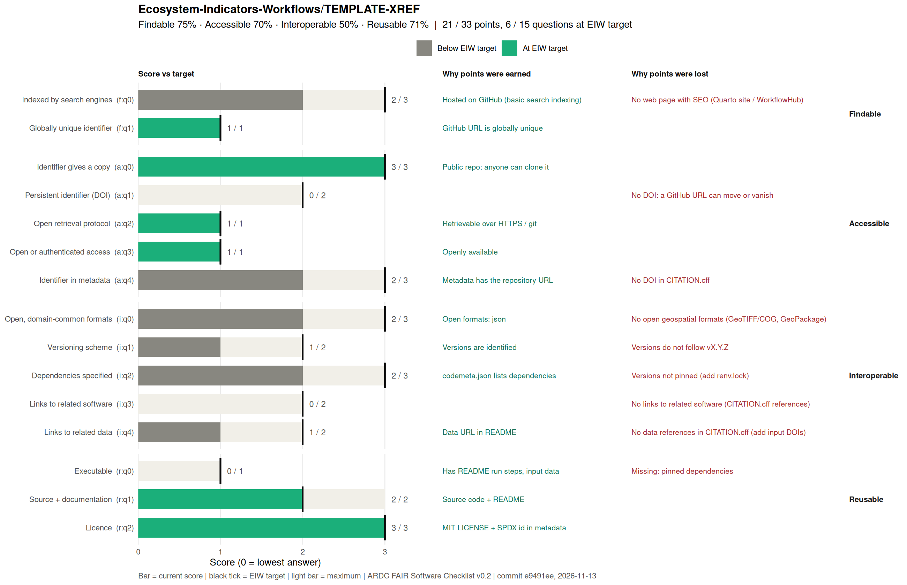

<!-- README.md is generated from README.qmd. Please edit that file -->

# Cross-referencing ecosystem survey name to the IUCN Global Ecosystem Typology: 90m Best-Candidate Spatial Synthesis

**Version:** \#TODO add Zenodo DOI and version number as badge.
**Release Date:** 2026-11-12\
**Dataset License:** [CC BY
4.0](https://creativecommons.org/licenses/by/4.0/) (with source spatial
data attribution to (ecosystem survey name) under ecosystem survey data
license) **Code License:** MIT\
**Workflow Repository:**
<https://github.com/Ecosystem-Indicators-Workflows/TEMPLATE-XREF>

> *Note: This `README.md` is dynamically generated from
> [`README.qmd`](README.qmd) by inspecting the output GeoTIFFs and CSV
> tables. To update all statistics after regenerating the data, run
> `quarto render output-best-candidate/README.qmd`.*

------------------------------------------------------------------------

## Authors & Contributors

- **J. R. Ferrer-Paris** (Corresponding author: `j.ferrer@unsw.edu.au`,
  ORCID: [0000-0002-9554-3395](https://orcid.org/0000-0002-9554-3395)) —
  *Centre for Ecosystem Science, UNSW Sydney; IUCN Commission on
  Ecosystem Management*
- **David A. Keith** — *Centre for Ecosystem Science, UNSW Sydney; IUCN
  Commission on Ecosystem Management*
- **Mark G. Tozer** — *Centre for Ecosystem Science, UNSW Sydney*
- **Elliot Gould** (ORCID:
  [0000-0002-6585-538X](https://orcid.org/0000-0002-6585-538X)) —
  *Centre for Ecosystem Science, UNSW Sydney*
- **Abhimanyu Raj Singh** (ORCID:
  [0000-0002-2279-7060](https://orcid.org/0000-0002-2279-7060)) — *QCIF;
  Centre for Ecosystem Science, UNSW Sydney*
- **placeholder** — \*placeholder

**Author Contributions:** A1 led the expert elicitation process. A1, A2,
A3, A4, and A5 contributed membership tables for cross-referencing. JRFP
led the technical documentation and synthesis workflow. JRFP, EG, and
ARS contributed scripts for data preparation, validation, analysis, and
spatial output generation.

# Repository File Structure

All workflow outputs are written to the `./results/` directory, with
each key output dataset in its own subdirectory. The `./results/`
directory is ignored by Git, but each subdirectory contains a
`README.qmd` file that is committed to the repository. The `README.qmd`
files are dynamically generated from the output datasets and contain
summary statistics, metadata, and references for each dataset.

# Repository Structure

## References

Core bibliographic references are recorded in `references/main.bib`,
including commented sections for main references and for software
references. Case-study specifc references are to be recorded in
`references/additional.bib`, including sections for data sources and
other case-study specific references.

# Repository Checklist

<!-- Delete this section once you have completed the checklist.  -->

- [ ] Update `CITATION.cff` with the correct title and authorship
  information.
- [ ] Update `README.qmd` with the correct title and authorship
  information in the YAML header and the `params$variable` variables.
- [ ] Update `additional.bib` with all case-study specific dataset or
  other references (including input and output datasets), for example:

<!-- -->

    @dataset{OUTPUT1_best_candidate,
      author       = {Ferrer-Paris, J. R. and
                      Tozer, Mark G. and
                      Gould, Elliot and
                      Singh, Abhimanyu Raj and
                      Balmer, Jayne and
                      Kitchener, Anne and
                      Latinovic, Adelina and
                      Keith, David A.},
      title        = {Cross-referencing Tasmanian vegetation map (TASVEG
                       5.0) to the IUCN Global Ecosystem Typology: 90m
                       Best-Candidate Spatial Synthesis
                      },
      month        = nov,
      year         = 2026,
      publisher    = {Zenodo},
      version      = {0.1.0},
    }

<!-- FAIR:START -->
## FAIR assessment

 

**21 / 33 points · 6 / 15 questions at EIW target** · not yet at EIW minimum

| Principle | Score | EIW target |
|---|---|---|
| Findable | 3 / 4 (75%) | 4 / 4 |
| Accessible | 7 / 10 (70%) | 10 / 10 |
| Interoperable | 6 / 12 (50%) | 12 / 12 |
| Reusable | 5 / 7 (71%) | 6 / 7 |

Gaps to close (9)

- **f:q0 Indexed by search engines** (2 / 3): No web page with SEO (Quarto site / WorkflowHub)
- **a:q1 Persistent identifier (DOI)** (0 / 2): No DOI: a GitHub URL can move or vanish
- **a:q4 Identifier in metadata** (2 / 3): No DOI in CITATION.cff
- **i:q0 Open, domain-common formats** (2 / 3): No open geospatial formats (GeoTIFF/COG, GeoPackage)
- **i:q1 Versioning scheme** (1 / 2): Versions do not follow vX.Y.Z
- **i:q2 Dependencies specified** (2 / 3): Versions not pinned (add renv.lock)
- **i:q3 Links to related software** (0 / 2): No links to related software (CITATION.cff references)
- **i:q4 Links to related data** (1 / 2): No data references in CITATION.cff (add input DOIs)
- **r:q0 Executable** (0 / 1): Missing: pinned dependencies

Updated 2026-11-13 from commit `e9491ee` by `.fair/fair_check.R`. Edit `.fair/fair-checklist.yml`, not this block.
<!-- FAIR:END -->
